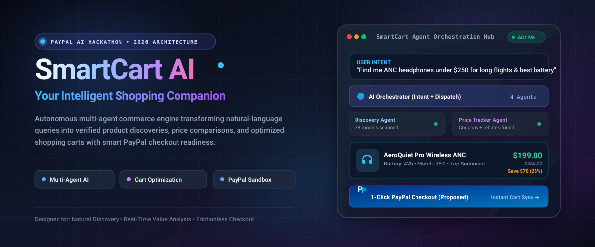
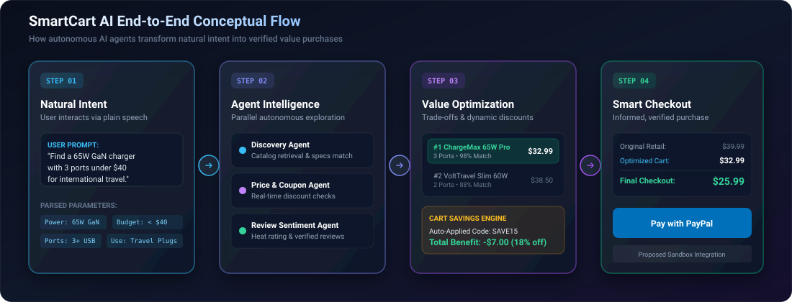
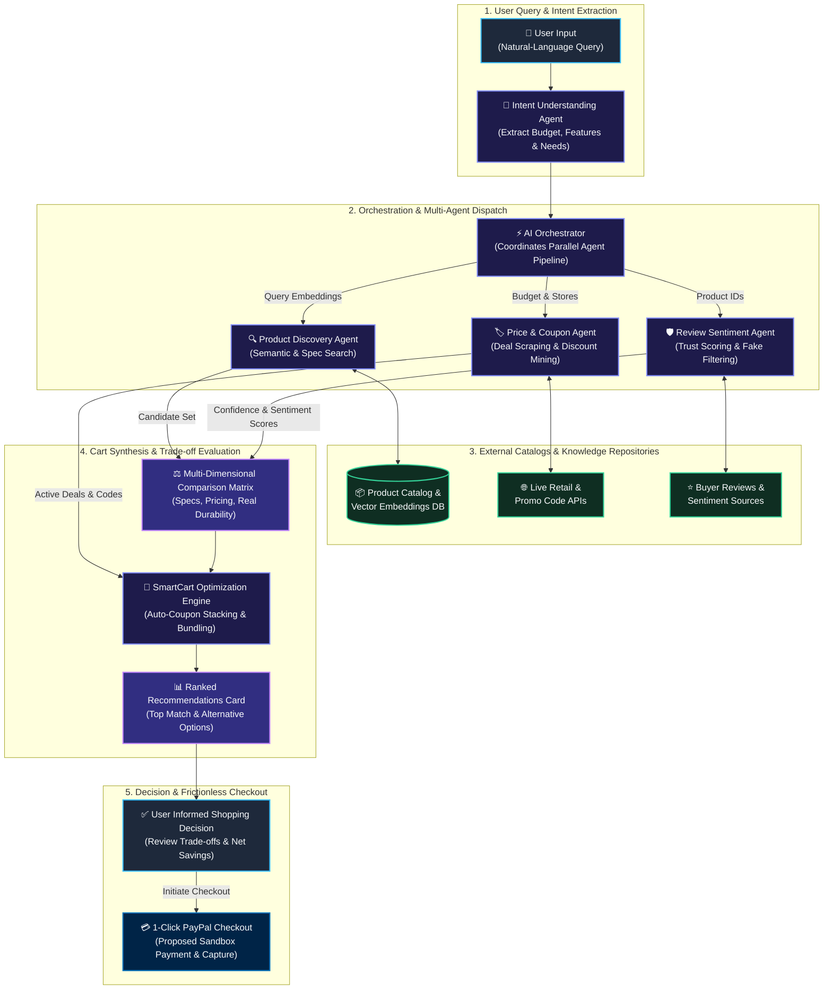
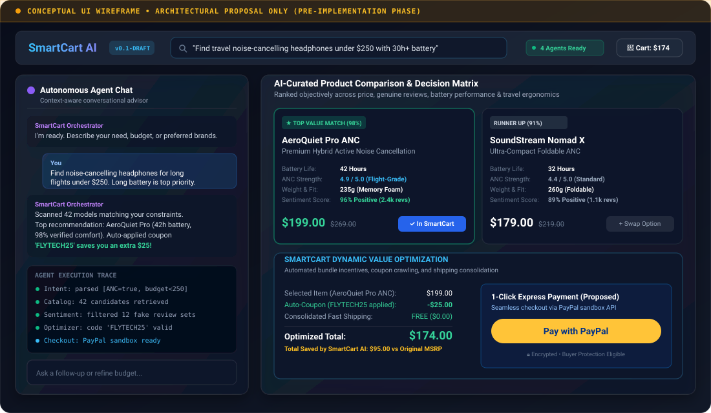

<p align="center">
  
</p>

<p align="center">
  <strong>An autonomous multi-agent commerce platform transforming conversational search into verified discoveries, real-time value comparisons, and optimized shopping carts.</strong>
</p>

<p align="center">
  <a href="#-project-overview"></a>
  <a href="#-technology-stack"></a>
  <a href="#-proposed-system-architecture"></a>
  <a href="#-license"></a>
</p>

---

## 📑 Table of Contents

- [🌟 Executive Summary](#-executive-summary)
- [🎯 Visual Project Overview](#-visual-project-overview)
- [🔄 End-to-End Workflow Flowchart](#-end-to-end-workflow-flowchart)
- [🏗️ Proposed System Architecture](#️-proposed-system-architecture)
- [🤝 Multi-Agent Interaction Model](#-multi-agent-interaction-model)
- [⚡ Planned Feature Highlights](#-planned-feature-highlights)
- [💻 Technology Stack (Confirmed vs Proposed)](#-technology-stack-confirmed-vs-proposed)
- [🎨 Conceptual UI Mockup & Preview](#-conceptual-ui-mockup--preview)
- [🗺️ Project Development Roadmap](#️-project-development-roadmap)
- [🚀 Planned Quickstart & Setup Guide](#-planned-quickstart--setup-guide)
- [🛡️ Privacy, Security & Responsible AI](#️-privacy-security--responsible-ai)
- [👥 Contributing & Hackathon Team](#-contributing--hackathon-team)
- [📄 License](#-license)

---

## 🌟 Executive Summary

Online shoppers are overwhelmed by information overload: thousands of conflicting reviews, volatile dynamic pricing, deceptive promotions, and tedious manual tab-switching across dozens of stores. 

**SmartCart AI** reimagines e-commerce through **Agentic Commerce**. Instead of navigating static catalogs, users simply state what they want, their budget, and personal constraints in plain language. A coordinated swarm of specialized AI agents analyzes specifications, tracks pricing histories, weeds out counterfeit feedback, and optimizes the final cart with stacking discounts—culminating in a frictionless 1-click **PayPal Checkout**.

> [!NOTE]
> **Project Maturity Notice:** SmartCart AI is currently in the **Architectural Specification and Design Phase** for the PayPal AI Hackathon. Diagrams and mockups represent the **proposed system architecture** and future development roadmap.

---

## 🎯 Visual Project Overview

The SmartCart AI interaction model replaces traditional keyword searches with a continuous, 4-stage intelligent commerce pipeline:

<p align="center">
  
</p>

### The 4 Pillars of SmartCart AI:

<table>
  <thead>
    <tr>
      <th width="25%">1. Natural Intent</th>
      <th width="25%">2. Agent Intelligence</th>
      <th width="25%">3. Value Optimization</th>
      <th width="25%">4. Informed Checkout</th>
    </tr>
  </thead>
  <tbody>
    <tr>
      <td>
        <strong>Conversational Input</strong><br>
        Shoppers state needs freely (e.g., <em>"Find 65W GaN travel charger under $40"</em>). The parser maps implicit criteria, power thresholds, and timeframes.
      </td>
      <td>
        <strong>Parallel Agent Swarm</strong><br>
        Specialized agents autonomously explore product catalogs, analyze semantic embeddings, mine active promotions, and verify user sentiment.
      </td>
      <td>
        <strong>Dynamic Cart Tuning</strong><br>
        Identifies bundle perks, applies valid coupon codes, balances cost vs quality trade-offs, and recommends the top-value match.
      </td>
      <td>
        <strong>Frictionless Payment</strong><br>
        Presents an actionable decision matrix with transparent cost savings, backed by seamless PayPal 1-Click Sandbox Checkout.
      </td>
    </tr>
  </tbody>
</table>

---

## 🔄 End-to-End Workflow Flowchart

The following flowchart illustrates how a shopper's natural language input moves across understanding, multi-agent evaluation, data sources, and final transaction completion:



---

## 🏗️ Proposed System Architecture

> [!IMPORTANT]
> **Proposed System Design:** This architecture represents the target design for SmartCart AI. It outlines the modular separation between frontend interfaces, asynchronous multi-agent orchestration, LLM reasoning pipelines, data persistence, and external payment integration.

```mermaid
flowchart TD
    classDef clientLayer fill:#0f172a,stroke:#38bdf8,stroke-width:2px,color:#f8fafc;
    classDef apiLayer fill:#1e1b4b,stroke:#818cf8,stroke-width:2px,color:#f8fafc;
    classDef agentLayer fill:#311042,stroke:#c084fc,stroke-width:2px,color:#f8fafc;
    classDef modelLayer fill:#142d4c,stroke:#60a5fa,stroke-width:2px,color:#f8fafc;
    classDef dataLayer fill:#062d2b,stroke:#2dd4bf,stroke-width:2px,color:#f8fafc;
    classDef extLayer fill:#1c1917,stroke:#fbbf24,stroke-width:2px,color:#f8fafc;
    classDef paypalLayer fill:#001c3d,stroke:#0070ba,stroke-width:2px,color:#f8fafc;

    subgraph Client["1. Frontend / User Interface (Proposed)"]
        UI_Web["Conversational Web Client<br/>(Next.js 14 / React &amp; Tailwind CSS)"]:::clientLayer
        UI_Chat["Real-Time Streaming Chat Drawer<br/>(Markdown, Product Cards, Telemetry)"]:::clientLayer
        UI_Matrix["Interactive Product Matrix<br/>(Side-by-Side Trade-off Visualizer)"]:::clientLayer
        UI_Cart["Dynamic SmartCart Drawer<br/>(Savings Ledger &amp; Promo Badges)"]:::clientLayer
    end

    subgraph Gateway["2. Backend Gateway &amp; API Layer (Proposed)"]
        API_GW["FastAPI / Python Gateway<br/>(Asynchronous REST Endpoints)"]:::apiLayer
        WS_Handler["WebSocket Session Hub<br/>(Bidirectional Agent Streaming)"]:::apiLayer
        Session_Mgr["Session &amp; Preference Store<br/>(Context Window Management)"]:::apiLayer
    end

    subgraph Agents["3. Multi-Agent Orchestration Engine (Proposed)"]
        Orchestrator["Agent Master Coordinator<br/>(LangGraph / StateGraph Orchestration)"]:::agentLayer
        IntentAgent["Intent Understanding Agent<br/>(Extract Filters, Budget, Priority)"]:::agentLayer
        DiscoveryAgent["Product Discovery Agent<br/>(Catalog Retrieval &amp; Semantic Matching)"]:::agentLayer
        PriceAgent["Price &amp; Coupon Tracker Agent<br/>(Discount Validation &amp; Stacking)"]:::agentLayer
        ReviewAgent["Review Sentiment Agent<br/>(Deceptive Review Detection)"]:::agentLayer
        CartAgent["Cart Optimization Agent<br/>(Bundle Perks &amp; Threshold Savings)"]:::agentLayer
        CheckoutAgent["Payment &amp; Order Agent<br/>(PayPal Order Dispatch &amp; Webhooks)"]:::agentLayer
    end

    subgraph LLM["4. LLM &amp; Embedding Reasoning Layer (Proposed)"]
        Gemini["Foundation LLMs<br/>(Google Gemini 1.5 Pro / Flash)"]:::modelLayer
        Embeddings["Embedding Engine<br/>(text-embedding-004)"]:::modelLayer
        Structured["JSON Schema &amp; Structured Outputs<br/>(Pydantic Type Guards)"]:::modelLayer
    end

    subgraph Storage["5. Persistence &amp; Caching Layer (Proposed)"]
        DB_Relational[("PostgreSQL<br/>(User Carts, Historical Orders)")]:::dataLayer
        DB_Vector[("Vector Database<br/>(pgvector / Qdrant)")]:::dataLayer
        DB_Cache[("Redis Cache<br/>(Real-Time Agent Session State)")]:::dataLayer
    end

    subgraph ExternalServices["6. Product Data &amp; External Feeds (Proposed)"]
        Ext_Catalog["Retail Product Catalogs<br/>(Mock APIs &amp; E-commerce Feeds)"]:::extLayer
        Ext_Coupons["Deal &amp; Coupon Crawlers<br/>(Promo Code Repositories)"]:::extLayer
        Ext_Reviews["Aggregated Review Datasets<br/>(Verified Purchaser Feedback)"]:::extLayer
    end

    subgraph PaymentIntegration["7. Payment Integration (Proposed Sandbox)"]
        PayPal_SDK["PayPal Orders v2 API<br/>(Sandbox Authentication &amp; Create Order)"]:::paypalLayer
        PayPal_Webhooks["PayPal Webhook Receiver<br/>(Payment Capture &amp; Cart Clearance)"]:::paypalLayer
    end

    UI_Web --> UI_Chat & UI_Matrix & UI_Cart
    UI_Chat & UI_Matrix & UI_Cart <-->|REST &amp; WebSockets| API_GW
    API_GW <--> WS_Handler
    API_GW <--> Session_Mgr

    WS_Handler <--> Orchestrator
    Orchestrator <--> IntentAgent & DiscoveryAgent & PriceAgent & ReviewAgent & CartAgent & CheckoutAgent

    IntentAgent & DiscoveryAgent & PriceAgent & ReviewAgent & CartAgent <--> Gemini
    Gemini <--> Structured
    DiscoveryAgent <--> Embeddings

    DiscoveryAgent <--> DB_Vector
    API_GW & Session_Mgr <--> DB_Relational
    WS_Handler <--> DB_Cache

    DiscoveryAgent <--> Ext_Catalog
    PriceAgent <--> Ext_Coupons
    ReviewAgent <--> Ext_Reviews

    CheckoutAgent <--> PayPal_SDK
    PayPal_SDK <--> PayPal_Webhooks
    PayPal_Webhooks --> API_GW
```



---

## 🤝 Multi-Agent Interaction Model

How do the proposed agents collaborate asynchronously without deadlocks or hallucinated advice? The sequence diagram below maps out the communication flow:

```mermaid
sequenceDiagram
    autonumber
    actor Shopper as 👤 Shopper
    participant UI as 🖥️ Conversational UI
    participant GW as 🚪 API Gateway
    participant Orch as ⚡ Master Orchestrator
    participant Intent as 🧠 Intent Agent
    participant Discovery as 🔍 Discovery Agent
    participant Price as 🏷️ Price Agent
    participant Review as 🛡️ Review Agent
    participant Cart as 🛒 Cart Optimizer
    participant PayPal as 💳 PayPal Sandbox

    Shopper->>UI: "Need ANC travel headphones under $250 with 30h+ battery"
    UI->>GW: POST /api/chat/stream
    GW->>Orch: Spawn shopping session & dispatch prompt
    
    Orch->>Intent: Extract structured shopping constraints
    Intent-->>Orch: {category: "Headphones", anc: true, max_budget: 250, min_battery_hrs: 30}

    par Concurrent Analysis
        Orch->>Discovery: Query vector store for candidates
        Discovery-->>Orch: Returns top 5 semantic matches
    and Pricing & Deals
        Orch->>Price: Crawl active discounts & promo codes
        Price-->>Orch: Found valid coupon: 'FLYTECH25' (-$25)
    and Trust & Sentiment
        Orch->>Review: Analyze authentic buyer reviews
        Review-->>Orch: Filter fake ratings; score comfort at 96%
    end

    Orch->>Cart: Calculate trade-offs, bundle discounts & budget savings
    Cart-->>Orch: Top match: AeroQuiet Pro ($199.00 vs $269 MSRP)
    
    Orch->>GW: Stream comparison matrix & dynamic cart update
    GW->>UI: Render live product card, savings ledger & recommendations
    
    Shopper->>UI: Clicks "Pay with PayPal"
    UI->>GW: POST /api/checkout/create-order
    GW->>PayPal: Create Order ($174.00 net after discount)
    PayPal-->>UI: Launch PayPal Checkout Approval Modal
    Shopper->>PayPal: Authorize payment securely
    PayPal-->>GW: Webhook: PAYMENT.CAPTURE.COMPLETED
    GW->>UI: Render Order Confirmation & Shipping Tracking
```

---

## ⚡ Planned Feature Highlights

SmartCart AI is designed around six intelligent modules engineered to turn tedious shopping research into an effortless experience:

<table>
  <thead>
    <tr>
      <th width="8%">Icon</th>
      <th width="24%">Module</th>
      <th width="50%">Key Capabilities</th>
      <th width="18%">Status</th>
    </tr>
  </thead>
  <tbody>
    <tr>
      <td align="center">🗣️</td>
      <td><strong>Conversational Discovery</strong></td>
      <td>
        Natural-language shopping query parsing, conversational back-and-forth clarifications, explicit constraint extraction (budget, brand, dimension, delivery).
      </td>
      <td><span style="color:#60A5FA;">● Planned</span></td>
    </tr>
    <tr>
      <td align="center">🤖</td>
      <td><strong>Multi-Agent Swarm</strong></td>
      <td>
        Dedicated autonomous agents for intent extraction, catalog retrieval, real-time pricing analysis, and sentiment moderation, coordinated via LangGraph.
      </td>
      <td><span style="color:#C084FC;">● In Design</span></td>
    </tr>
    <tr>
      <td align="center">⚖️</td>
      <td><strong>Decision Matrix</strong></td>
      <td>
        Objective side-by-side trade-off breakdowns across specifications, true longevity, battery efficiency, and value-per-dollar rather than raw sponsor placement.
      </td>
      <td><span style="color:#60A5FA;">● Planned</span></td>
    </tr>
    <tr>
      <td align="center">🏷️</td>
      <td><strong>Cart &amp; Budget Optimizer</strong></td>
      <td>
        Dynamic bundle evaluation, automated coupon discovery, shipping threshold calculation, and multi-vendor cost minimization algorithms.
      </td>
      <td><span style="color:#60A5FA;">● Planned</span></td>
    </tr>
    <tr>
      <td align="center">🛡️</td>
      <td><strong>Review Sentiment Guard</strong></td>
      <td>
        Deep sentiment parsing of customer feedback to identify sponsored or spoofed reviews, highlighting authentic pros, cons, and common failure points.
      </td>
      <td><span style="color:#FBBF24;">● Exploratory</span></td>
    </tr>
    <tr>
      <td align="center">💳</td>
      <td><strong>PayPal Smart Checkout</strong></td>
      <td>
        Native 1-click checkout with PayPal Sandbox API integration, cart synchronization, automated currency calculation, and buyer protection.
      </td>
      <td><span style="color:#34D399;">● Planned (Core)</span></td>
    </tr>
  </tbody>
</table>

---

## 💻 Technology Stack (Confirmed vs Proposed)

To maintain complete architectural integrity, technologies are explicitly categorized between confirmed project baselines and proposed candidate frameworks under evaluation:

### 🟢 Confirmed Technologies (Baseline Choices)

These technologies represent the confirmed foundation for the repository and project infrastructure:

<p align="left">
  
  
  
  
  
</p>

### 🟡 Proposed Technologies (Candidate Architecture)

The following frameworks and services are currently proposed for the hackathon prototype:

| Architectural Tier | Candidate Technologies | Evaluation Criteria & Rationale |
|:---|:---|:---|
| **Frontend Framework** | `Next.js 14` / `React` + `Tailwind CSS` | High-performance Server-Side Rendering (SSR), responsive layout, fluid streaming UI support. |
| **Backend Gateway** | `FastAPI` (Python) | Native async support, high throughput, automatic OpenAPI documentation, tight Python ML ecosystem binding. |
| **Agent Orchestrator** | `LangGraph` / `LangChain` / `Google Antigravity SDK` | Graph-based cyclic agent state management, human-in-the-loop validation, checkpointing. |
| **Foundation Models** | `Google Gemini 1.5 Flash` & `Gemini 1.5 Pro` | Exceptional 1M+ context window, native structured JSON outputs, ultra-fast latency for real-time chat. |
| **Vector Database** | `pgvector` (PostgreSQL) / `Qdrant` | Efficient high-dimensional semantic search over product catalog embeddings. |
| **Cache & State Store** | `Redis` | In-memory storage for active conversational session state and live agent telemetry logs. |
| **Payment Gateway** | `PayPal Orders v2 REST API` + `PayPal JS SDK` | Industry standard sandbox checkout, 1-click payment authorization, instant buyer confidence. |

---

## 🎨 Conceptual UI Mockup & Preview

> [!NOTE]
> **Pre-Implementation Mockup:** The interface below is a conceptual wireframe created to illustrate the planned user experience. The application is currently under design and development.

<p align="center">
  
</p>

### Walkthrough of the Proposed Interface:

1. **Top Intent Bar:** Shoppers enter descriptive prompts or upload reference product links. Live agent telemetry badges reflect active background workers.
2. **Autonomous Agent Drawer (Left):** Real-time conversational dialogue with streaming agent trace logs showing query extraction, catalog filtering, and coupon tests.
3. **Curated Decision Matrix (Center):** Ranked product cards highlighting the "Top Value Match" based on objective metric scoring (battery, noise cancellation, weight, sentiment) instead of paid ad placements.
4. **SmartCart Optimizer & PayPal Checkout (Bottom):** Live ledger itemizing retail pricing, automatically applied promo codes (e.g., `-$25.00`), consolidated shipping, and an integrated **PayPal 1-Click Checkout** button.

---

## 🗺️ Project Development Roadmap

Our phased milestone plan structures the project from architecture specification through the final hackathon demonstration:

- [x] **Phase 1: Problem Definition & Architecture Specification**
  - [x] Identify core pain points in modern e-commerce discovery and cart abandonment.
  - [x] Formulate multi-agent collaboration specifications (Intent, Discovery, Pricing, Sentiment, Cart).
  - [x] Draft end-to-end Mermaid workflow and system architecture diagrams.
  - [x] Design conceptual visual identity, hero banner, and UI wireframe assets.
- [ ] **Phase 2: Core Agent Engine & Mock Catalog Prototype**
  - [ ] Set up Python 3.11 environment and agent orchestration state graph.
  - [ ] Implement Intent Parsing Agent with structured JSON schema outputs.
  - [ ] Ingest sample e-commerce catalog dataset with vector embeddings.
  - [ ] Build basic Discovery Agent with semantic similarity retrieval.
- [ ] **Phase 3: Conversational Shopping Frontend**
  - [ ] Scaffold Next.js 14 frontend with Tailwind CSS and responsive design.
  - [ ] Build streaming chat drawer with WebSocket connection to backend.
  - [ ] Create interactive Product Comparison Matrix cards.
  - [ ] Implement live agent execution trace indicator in the UI.
- [ ] **Phase 4: Cart Optimization & Multi-Vendor Engine**
  - [ ] Develop Price & Coupon Tracker Agent with mock deal verification.
  - [ ] Implement SmartCart optimizer algorithm (budget balancing & bundling).
  - [ ] Integrate Review Sentiment Agent for authentic customer trust scoring.
- [ ] **Phase 5: PayPal Payment Sandbox Integration**
  - [ ] Configure PayPal Developer account and sandbox credentials.
  - [ ] Implement backend order creation endpoint via PayPal Orders v2 REST API.
  - [ ] Integrate PayPal Smart Payment Buttons on the frontend checkout drawer.
  - [ ] Implement webhook receiver for `PAYMENT.CAPTURE.COMPLETED`.
- [ ] **Phase 6: Verification, Polishing & Demo Preparation**
  - [ ] End-to-end user journey testing and latency optimization.
  - [ ] Record demonstration walkthrough video for the hackathon submission.
  - [ ] Finalize production-ready documentation and submission materials.

---

## 🚀 Planned Quickstart & Setup Guide

*(For developers when implementation begins)*

### Prerequisites

- **Python 3.11+** installed
- **Node.js 18+** & `npm` / `pnpm`
- **Git** installed
- **PayPal Developer Account** (for sandbox client credentials)
- **Gemini API Key** (or alternative LLM API key)

### Target Installation Steps

```bash
# 1. Clone the repository
git clone https://github.com/sujitkr268/paypal-ai-hackathon.git
cd paypal-ai-hackathon

# 2. Setup backend virtual environment (Planned)
python -m venv .venv
# Windows:
.venv\Scripts\activate
# Unix/macOS:
# source .venv/bin/activate

# 3. Install backend dependencies (Planned)
pip install -r requirements.txt

# 4. Configure environment variables
cp .env.example .env
# Edit .env to add your GEMINI_API_KEY, PAYPAL_CLIENT_ID, and PAYPAL_CLIENT_SECRET

# 5. Start the backend service (Planned)
uvicorn app.main:app --reload --port 8000

# 6. In a new terminal, launch the frontend (Planned)
cd frontend
npm install
npm run dev
```

---

## 🛡️ Privacy, Security & Responsible AI

SmartCart AI is built on principles of consumer transparency and data safety:

- **Unbiased Recommendation Engine:** Agent rankings are driven purely by spec compatibility, price-to-performance ratio, and verified reviews—not sponsored ad tiers.
- **Data Minimization:** Shopping intent queries do not require permanent personally identifiable information (PII) storage.
- **Secure Payments:** Payment processing is delegated entirely to the **PayPal Sandbox / Orders v2 API**. Sensitive financial data or card details never touch SmartCart AI servers.
- **Deceptive Content Filtering:** The Review Sentiment Agent explicitly identifies bot-generated or anomalous review spikes to prevent consumers from buying misleading goods.

---

## 👥 Contributing & Hackathon Team

SmartCart AI is being developed as an open-source innovation prototype for the **PayPal AI Hackathon 2026**.

Feedback, architectural suggestions, and discussions are welcome! Feel free to:
1. Fork the repository.
2. Create your feature branch (`git checkout -b feature/agent-optimization`).
3. Commit your changes (`git commit -m "Add coupon crawler agent"`).
4. Push to the branch (`git push origin feature/agent-optimization`).
5. Open a Pull Request.

---

## 📄 License

This project is licensed under the [MIT License](LICENSE) — see the LICENSE file for details.

---

<p align="center">
  <sub>Built with 💙 for the <strong>PayPal AI Hackathon 2026</strong>. Reimagining commerce through intelligent multi-agent orchestration.</sub>
</p>
